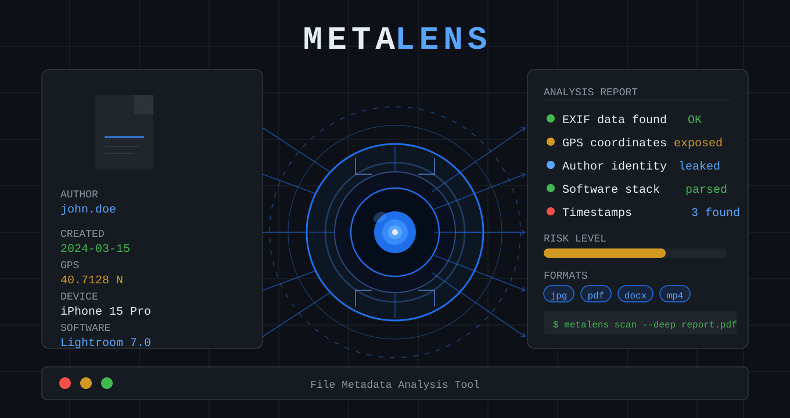

# 🔍 MetaLens

[](../../releases/latest)
[](../../releases)


<p align="center">
  
</p>

**Universal File Metadata Manager** — read, edit, delete and compare metadata across all major file formats, offline by default.

> [!TIP]
> 💡 **No account, no cloud, no setup.** Download a binary, double-click, and start browsing. MetaLens never touches the network unless you ask it to check for a new version (see [Privacy & Security](#-privacy--security)).

---

## 📚 Documentation Index

| 📄 Document                                | 📝 Purpose                                   |
| ------------------------------------------- | -------------------------------------------- |
| [📋 REQUIREMENTS.md](docs/REQUIREMENTS.md) | System requirements and prerequisites        |
| [🚀 INSTALLATION.md](docs/INSTALLATION.md) | Step-by-step installation & build-from-source |
| [📖 USAGE.md](docs/USAGE.md)               | How to use the application                   |
| [📡 API.md](docs/API.md)                   | Sidecar REST API reference for developers    |

---

## ⚡ Quick Start

### 🪟 Windows / 🐧 Linux

1. Grab the latest installer for your platform from [Releases](../../releases)
2. Run it — Windows SmartScreen may warn since the build is unsigned; click **"More info" → "Run anyway"**
3. MetaLens opens with a folder tree on the left — click a folder, then a file, to see its metadata

> ⏱️ **No install wait, no dependency download.** Python and Node.js are bundled into the binary — nothing to set up.

> [!IMPORTANT]
> ✅ For full details, see [INSTALLATION.md](docs/INSTALLATION.md)

---

## 🎯 What It Does

```
File (image / audio / video / document / anything)
         │
         ▼
┌─────────────────────────────────────────────┐
│  🖼️ Images   → EXIF, XMP, IPTC (JPEG edit)  │
│  🎵 Audio    → ID3, Vorbis, ASF, APEv2, MP4 │
│  🎬 Video    → MP4/MOV tags, other: read    │
│  📄 PDF      → document info + XMP          │
│  📊 Office   → OOXML core/app/custom, OLE   │
│  📁 Any file → size, timestamps, attributes,│
│               xattr; hachoir fallback       │
└─────────────────────────────────────────────┘
         │
         ▼
   👁️ View · ✏️ Edit · 🗑️ Delete · ⚖️ Diff · 🔑 Hash
```

---

## ✨ Key Features

- 🗂️ **File-manager UI** — folder tree + file list + metadata detail panel
- 🖼️ **All major formats** — images (JPEG/PNG/TIFF/WebP/GIF/RAW), audio (MP3/FLAC/OGG/Opus/M4A/WAV/AIFF/WMA/APE), video (MP4/MOV/MKV/AVI), documents (PDF/DOCX/XLSX/PPTX/DOC/XLS/PPT); any other file through the hachoir fallback and the filesystem layer
- ✏️ **Typed editing** — read, edit, add and delete individual fields with inputs matching their type (text, numbers, booleans, dates with UTC offset, exact rationals, lists); the sidecar validates every value and decides what is editable
- 🔒 **Verified atomic writes** — changes go to a private copy beside the file, are read back and checked, then replace the original (`ReplaceFileW` on Windows, `os.replace` elsewhere); a failure leaves the file untouched
- ↩️ **Exact Undo** — up to 50 saves per session, restored byte for byte in the usual case (pictures and other binaries included; very large changes fall back to restoring the values); refused if the file changed meanwhile
- 🔑 **File integrity hashes** — on-demand MD5 / SHA-1 / SHA-256 / SHA-512 / BLAKE2b with one-click copy
- 🎨 **Cyber dark theme** — professional dark UI with cyan/blue accents
- 📦 **Compiled binaries** — no Python or Node.js required to run
- 💾 **Offline-first** — zero telemetry; the only network call is the optional update check
- 🔔 **Update check** — manual from *About* / *Help*, or opt-in at startup; downloads are SHA-256 verified
- 🆓 **Free & open-source** — MIT license

---

## 🔧 Version

**v0.3.5** (latest stable) — Security and reliability release: every sidecar API call is authenticated with a per-session token, the Electron renderer is sandboxed with a Content Security Policy, PDF/Office edits preserve unrelated content, audio/video edits are atomic, and Undo restores original values. Dependencies updated (Pillow, pypdf, Vite, Electron). No API changes.

**Next: 0.4.0** (in development, not yet released) — update check and repository link in *About*; XMP and IPTC reading and writing for JPEG; typed values (lists, numbers, dates, exact rationals) instead of joined strings; adding fields; exact server-side Undo; uniform API errors; Linux packages built on a RHEL 9 baseline (Ubuntu 22.04+, Debian 12+, Fedora, RHEL 9/10).

📖 **See full version history** → [CHANGELOG.md](./CHANGELOG.md)

---

## 📋 System Requirements

- **Windows** 10/11 (64-bit) or **Linux** with glibc 2.34+ (Ubuntu 22.04+, Debian 12+, Fedora, RHEL 9/10): `.deb`/`.rpm`/`.tar.gz` — see [REQUIREMENTS.md](docs/REQUIREMENTS.md)
- **RAM** 512 MB free
- **Disk** ~300 MB installed
- No Python or Node.js needed to *run* the app — only to build it from source

> [!IMPORTANT]
> ✅ For complete requirements, see [REQUIREMENTS.md](docs/REQUIREMENTS.md)

---

## 🚀 Getting Started

### 1️⃣ Install
Follow [INSTALLATION.md](docs/INSTALLATION.md) for Windows/Linux binaries or building from source.

### 2️⃣ Start Browsing
Learn the interface in [USAGE.md](docs/USAGE.md).

### 💻 For Developers
Explore the sidecar API in [API.md](docs/API.md).

---

## 🗂️ Supported Formats

| Category | Formats | Read | Write |
|---|---|---|---|
| Images | JPEG — EXIF/GPS, XMP, IPTC-IIM (also JFIF header, comments, Multi-Picture index and ICC profile, read-only) | ✅ | ✅ |
| Images | PNG (text, `eXIf`, XMP, ICC, header), WebP (EXIF, XMP, ICC), TIFF (EXIF, XMP, IPTC, ICC) — EXIF/XMP can be edited and added, PNG text and the IPTC record of a TIFF removed | ✅ | ✅ |
| Images | GIF (comment), BMP, ICO | ✅ | — |
| Images | HEIC, HEIF, AVIF — size, rotation, EXIF/GPS, XMP, ICC (EXIF/XMP edited, added and removed in place) | ✅ | ✅ |
| Images (RAW) | CR2, NEF, ARW, DNG, ORF, RW2, RWL, PEF, SRW and other TIFF-based RAW (EXIF, XMP, IPTC) — changes are experimental and never move existing data | ✅ | ✅ |
| Images (RAW) | Canon CR3 and Fujifilm RAF (EXIF, GPS, preview metadata) | ✅ | — |
| Audio | MP3, WAV, AIFF, TTA (ID3) · FLAC, OGG, OGA, Opus, SPX (Vorbis comments) · WMA (ASF) · APE, WV, MPC (APEv2) · M4A (MP4 atoms) | ✅ | ✅ |
| Audio | AAC (ADTS/ADIF) | ✅ | — |
| Video | MP4, M4V, MOV, M4B, M4R (MP4 atoms; structure: brand, dates, tracks, rotation, codec, frame rate; dates, location, device and text entries and XMP can be edited, added and removed) | ✅ | ✅ |
| Video | MKV, WebM, MKA (title, tags, attachments, tracks; removed or rewritten in place) | ✅ | ✅ |
| Video | AVI, WMV, FLV, TS, MTS, M2TS (via hachoir) | ✅ | — |
| Documents | PDF — document info + XMP (the XMP stream can be removed as a whole; not encrypted, not digitally signed) | ✅ | ✅ |
| Office | DOCX, XLSX, PPTX, DOCM, XLSM, PPTM — core properties (not digitally signed); `app.xml`/`custom.xml` values can be removed | ✅ | ✅ |
| OpenDocument | ODT, ODS, ODP, ODG and templates (`meta.xml`) | ✅ | ✅ |
| E-books | EPUB (package metadata; identifier, title and language stay) | ✅ | ✅ |
| Office (legacy) | DOC, XLS, PPT, DOT, XLT, POT (OLE property sets; properties can be removed, not edited) | ✅ | 🗑️ remove |
| Any file | Filesystem: `fs:mtime` writable; size, other timestamps, permissions/owner (POSIX), Windows attributes read-only; xattr (Linux: `user.` writable; macOS: read-only) | ✅ | ✅ (mtime, xattr) |
| Other | Many more formats recognized from their content via hachoir | ✅ | — |

Files without an extension are recognized from their content. Every change is verified (the picture, audio or video data must come out identical) and can be undone.

### 🛡️ Sharing files safely

The **Share** tab removes what a file reveals before you send it (location, identity, device, dates, software, thumbnails, edit history), with a preview and Undo. The **Batch** button of the file list does the same on many files and also shifts dates, copies metadata between files, adds a position (fixed or from a GPX track), renames from metadata and exports a folder to CSV or JSON.

### 🔑 File Integrity

Compute cryptographic hashes on demand from the **Metadata** panel — no impact on browsing performance:

| Algorithm | Notes |
|---|---|
| MD5 | Legacy, widely used for checksums |
| SHA-1 | Legacy, used by Git and many tools |
| SHA-256 | Modern standard, recommended |
| SHA-512 | High-security workloads |
| BLAKE2b | Fast modern algorithm, built into Python |

---

## 🏗️ Architecture

| Layer | Technology | Notes |
|---|---|---|
| **Desktop shell** | Electron (Node.js main process) | Spawns the Python sidecar, native menus & dialogs |
| **Renderer UI** | React 19, Vite, TailwindCSS v4 | Folder tree, file list, metadata detail panel |
| **Sidecar** | Python 3.13, FastAPI, uvicorn | Metadata extraction/write engine, `127.0.0.1` only |

```
Electron Main (Node.js)
    ├── Spawns Python sidecar (FastAPI, localhost only)
    ├── Manages window, native menus, file dialogs
    └── IPC bridge (contextBridge): dialogs, paths, menu events, and the
        sidecar port + session token for the renderer

React renderer ── HTTP + Bearer token ──▶ Python Sidecar (127.0.0.1)

Python Sidecar (FastAPI)
    ├── /list   — directory listing with handler detection
    ├── /read   — full metadata extraction (format + filesystem layer)
    ├── /write  — verified atomic write (and optional deletes) in one save
    ├── /delete — field removal
    ├── /undo   — exact undo of a save by its token
    ├── /diff   — metadata comparison
    └── /hash   — on-demand file hashing

React Frontend (Vite + TailwindCSS)
    ├── FolderPanel  — folder tree navigation
    ├── FilePanel    — file list with metadata summary
    └── DetailPanel  — Metadata / Edit / Diff tabs
```

📖 Full endpoint reference → [API.md](docs/API.md)

---

## 📊 Test Suite

Automated Python, Electron and React suites cover metadata handlers, file integrity and rollback,
path validation, sidecar authentication, desktop security, Undo, asynchronous UI updates and release notes.

```bash
pytest python/tests/ -v
cd electron && npm test
cd ../frontend && npm test
```

---

## 🔐 Privacy & Security

- 🛡️ **No cloud dependencies** — everything runs locally
- 🔒 **No telemetry** — zero data collection
- 📁 **Localhost-only sidecar** — the Python API never binds beyond `127.0.0.1`
- 🔓 **Open source** — fully auditable code
- ⚡ **Offline by default** — no internet connection required. The only network access is the update check against the public GitHub Releases API, started by you (**About → Check for updates** or **Help → Check for Updates…**) or, if you enable it, once at startup. It sends no file data, paths or identifiers (only a `User-Agent: MetaLens/<version>` header). Settings are stored locally in `settings.json` in the app data folder

📖 See [SECURITY.md](./SECURITY.md) for the full security model.

---

## 🤝 Contributing

Contributions are welcome! Please:

1. Fork the repository
2. Create a feature branch (`git checkout -b feature/your-feature`)
3. Commit changes with clear messages
4. Push to your fork
5. Open a Pull Request to `develop` branch

📖 See [CONTRIBUTING.md](./CONTRIBUTING.md) for the full guide.

> [!NOTE]
> 📖 All PRs should target the **`develop`** branch, not `main`.

---

## 📜 License

Distributed under the **MIT License**. See [LICENSE](LICENSE) for details.

---

## 🙋 Support

- 📖 **Documentation:** See [docs/](docs/) folder
- 🐛 **Report issues:** [GitHub Issues](https://github.com/overwrite00/MetaLens/issues)
- 💬 **Questions:** Open a [GitHub Discussion](https://github.com/overwrite00/MetaLens/discussions)

---

## 👨‍💻 Credits

Developed by **Graziano Mariella**

Distributed with MIT License · [View License](LICENSE)

---

*Last updated: 2026-11-03*
*← [Requirements](docs/REQUIREMENTS.md) | [Docs →](docs/)*
